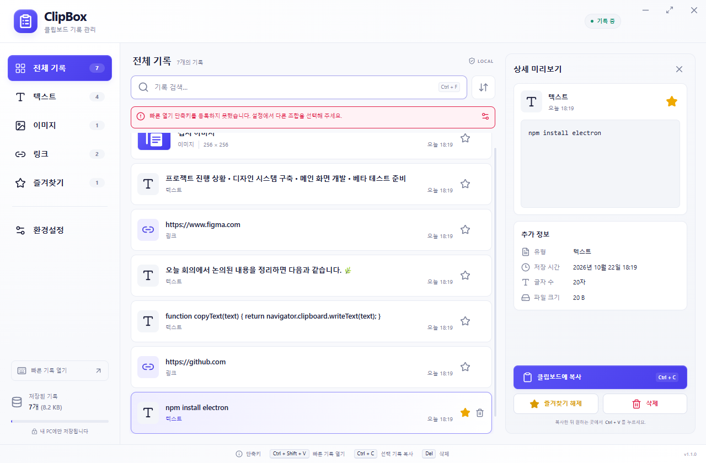

# ClipBox

**복사한 모든 것을, 언제든 다시.**

텍스트·링크·이미지를 내 컴퓨터에 보관하고, 단축키로 찾아 다시 복사하는 데스크톱 클립보드 매니저입니다. 계정이나 서버 없이 동작합니다.

[시작하기](docs/GETTING_STARTED.md) · [문서 모음](docs/README.md) · [플랫폼 지원](docs/07_CROSS_PLATFORM.md) · [변경 이력](CHANGELOG.md)



*Windows 1.1 실제 테스트 화면입니다. 기록은 합성 테스트 데이터이며, 단축키 충돌 안내가 표시된 상태입니다.*

## 주요 기능

- **기록 관리** — 텍스트·링크·PNG 이미지 수집, 원문 미리보기, 검색·유형 필터·정렬
- **빠른 접근** — 전역 단축키, 검색 자동 포커스, 방향키 선택과 Enter 재복사
- **즐겨찾기와 정리** — 즐겨찾기 보존, 저장 개수·보관 기간 설정, 삭제 확인
- **데스크톱 통합** — 트레이·macOS 메뉴 막대, 로그인 자동 실행, 일시정지
- **편안한 화면** — 한국어 UI, 라이트·다크·시스템 테마, 작은 창 대응
- **로컬 처리** — SQLite 저장, 재시작 후 기록 유지, 외부 전송 없음

## 플랫폼 지원 상태

현재 소스 버전은 **1.1.0**입니다. 구현·패키징 상태와 실제 실행 검증 범위를 구분합니다.

| 플랫폼 | 패키지 | 확인된 범위 |
|---|---|---|
| Windows x64 | NSIS `.exe` | 1.1 소스 E2E 통과. 생성·실행 검증된 배포물은 1.0이며 1.1 설치 파일은 별도 빌드 필요 |
| Linux x64 | `.tar.gz` | 1.1 아카이브 생성, ELF·번들·실행 권한 확인. 네이티브 실행은 미검증 |
| macOS Intel / Apple Silicon | `.dmg` / `.zip` | 빌드 구성 완료. 네이티브 빌드·실행·서명·공증은 미수행 |

Linux는 **X11 우선**입니다. Wayland의 백그라운드 클립보드 수집·전역 단축키·팝업 포커스는 데스크톱과 포털에 따라 제한됩니다. macOS·Linux는 네이티브 검수가 필요한 후보입니다. [상세 상태와 검수 항목](docs/07_CROSS_PLATFORM.md)을 확인하세요.

## 소스에서 실행

Node.js **24 이상**, npm, 그래픽 데스크톱 환경이 필요합니다. 저장소 루트에서 실행합니다.

```sh
git clone https://github.com/treeview-official/ClipBox.git
cd ClipBox
npm ci
npm run dev
```

처음 실행하면 기록 수집 동의를 선택합니다. 동의 후 다른 앱에서 새 내용을 복사해 보세요.

| 동작 | Windows / Linux | macOS |
|---|---|---|
| 빠른 기록 열기 | Ctrl + Shift + V | ⌘ + Shift + V |
| 검색창 이동 | Ctrl + F | ⌘ + F |
| 선택 기록 복사 | Ctrl + C | ⌘ + C |
| 대상 앱에 붙여넣기 | Ctrl + V | ⌘ + V |

퀵 팝업에서는 ↑/↓로 선택하고 **Enter로 복사 후 닫기**, Esc로 닫기를 수행합니다. 자동 붙여넣기는 제공하지 않습니다. 설치·설정·전체 단축키는 [시작 가이드](docs/GETTING_STARTED.md)에 정리했습니다.

## 빌드와 검증

```sh
npm run typecheck
npm test
npm run build
```

| 명령 | 결과 |
|---|---|
| `npm run dist:win` | Windows x64 NSIS 설치 파일 |
| `npm run dist:mac` | Intel·Apple Silicon용 DMG + ZIP; macOS에서 실행 |
| `npm run dist:linux` | Linux x64 TAR.GZ |
| `npm run pack` | 현재 OS의 실행 폴더 |

산출물은 `release/1.1.0/`에 생성되며 Git 소스에는 포함하지 않습니다. `npm run dist`는 현재 OS를 선택하고, `npm run dist:linux:archive`는 Linux TAR.GZ 생성 별칭입니다. [CI](.github/workflows/ci.yml)는 main 푸시·PR에서 세 운영체제의 타입 검사·단위 검사·빌드를 실행합니다. [수동 빌드 워크플로](.github/workflows/build-desktop.yml)는 설치 패키지 생성용이며 아직 실행하지 않았습니다.

**기록된 검증 결과:** 타입 검사 통과, 단위 검사 **37개 통과·POSIX 전용 2개 건너뜀**, Windows 소스 E2E **15개 통과**. [검증 데이터](artifacts/qa/cross-platform-results.json)와 [플랫폼별 범위](docs/07_CROSS_PLATFORM.md)를 확인할 수 있습니다. `npm run test:e2e`는 Windows 기준이며 시스템 클립보드를 사용하는 검사입니다.

## 개인정보와 저장

기록 수집은 **명시적으로 동의한 뒤** 시작합니다. 모든 기록은 로컬에 **평문**으로 저장하며, 비밀번호·카드번호·인증 토큰을 자동 제외하지 않습니다. 민감한 내용을 복사하기 전 기록을 끄거나 일시정지하세요.

기본값은 자동 시작 OFF, 백그라운드 유지 ON, 일반 기록 1,000개, 보관 30일입니다. 즐겨찾기는 자동 정리에서 제외됩니다. 저장 위치는 환경설정의 **정보**에서 확인할 수 있습니다. [저장 정책과 데이터 위치](docs/GETTING_STARTED.md#저장과-개인정보)를 참고하세요.

## 프로젝트 구조

```text
electron/       창·클립보드·저장소·OS 통합·제한된 IPC
src/            React 화면과 스타일
shared/         공통 타입과 플랫폼별 단축키 처리
tests/          저장소·수집·플랫폼 단위 검사
scripts/        개발·빌드·데스크톱 검증
docs/           사용법·명세·검증 기록
design/mockups/ 원본 UI 참고 시안
artifacts/qa/   실제 테스트 화면과 결과
```

Electron 45, React 19, TypeScript, Vite, 내장 `node:sqlite`를 사용합니다. `contextIsolation`, sandbox, CSP를 적용하고 렌더러의 직접 Node 접근과 외부 탐색을 제한합니다.

## 라이선스

현재 [package.json](package.json)의 라이선스 표기는 `UNLICENSED`이며, 별도의 오픈소스 라이선스를 부여하지 않습니다.
