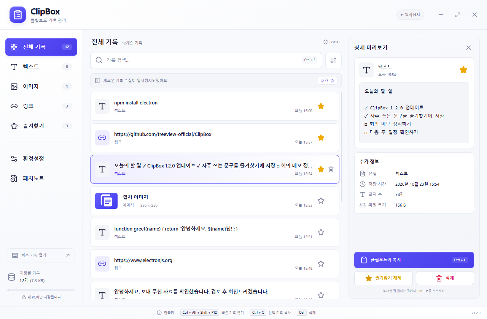
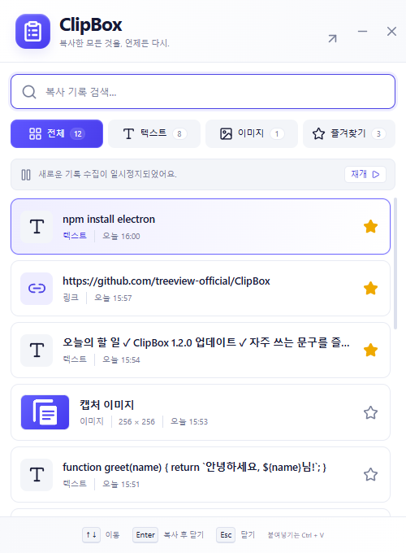
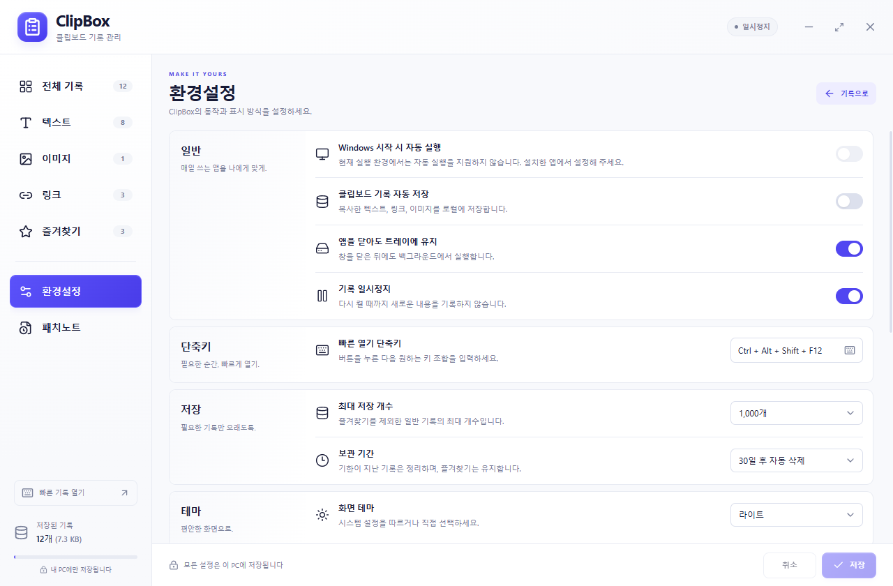
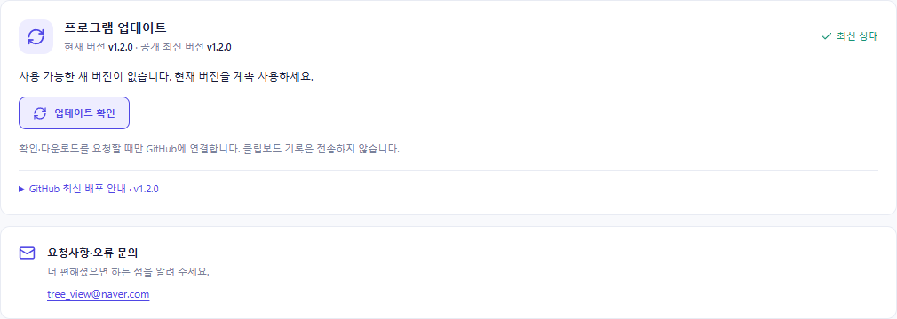
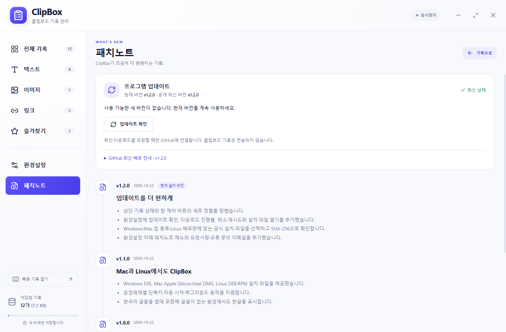
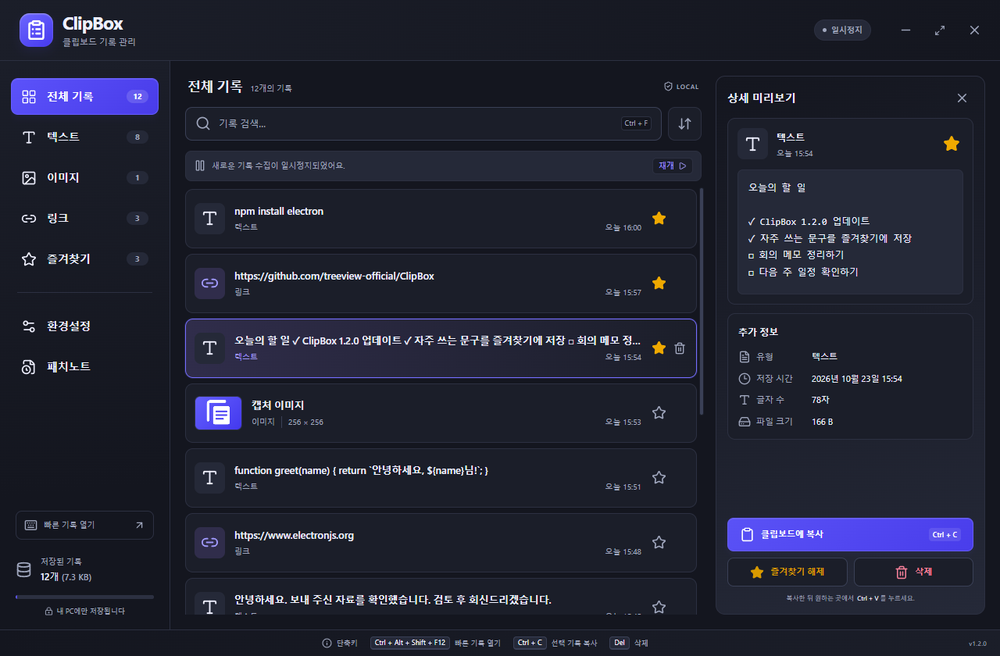
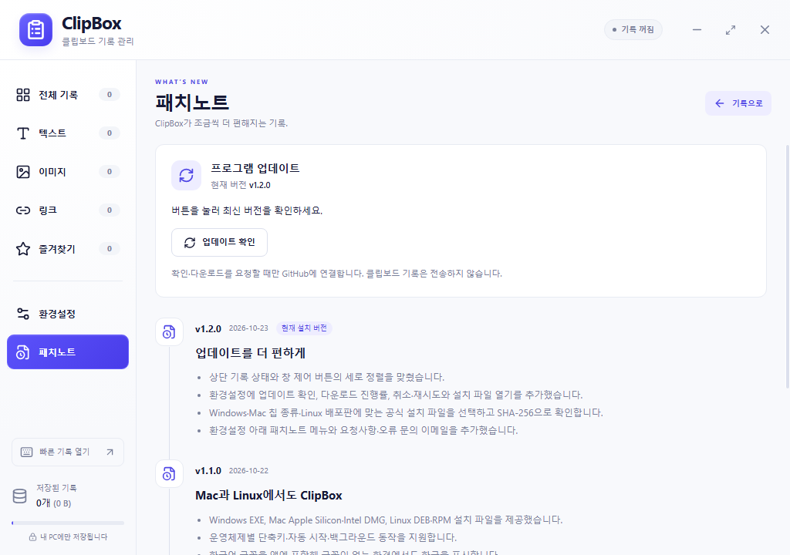
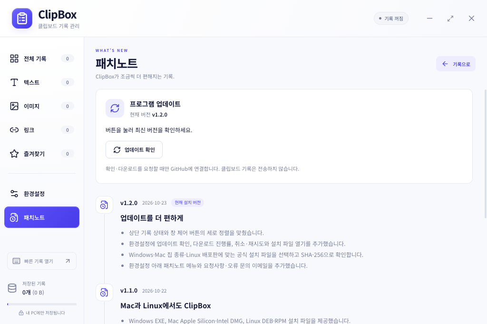
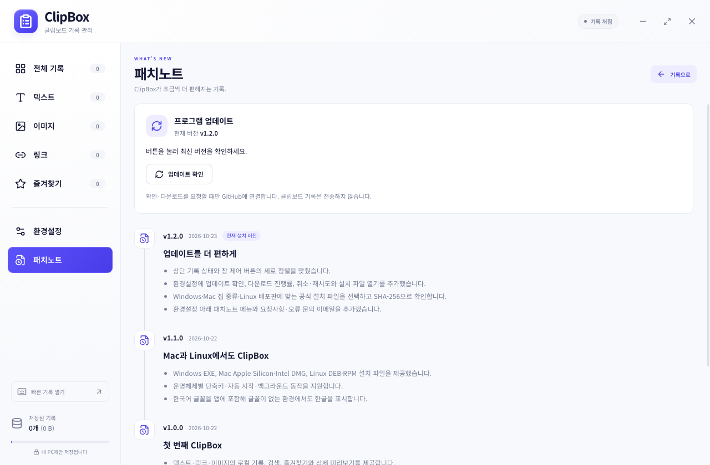
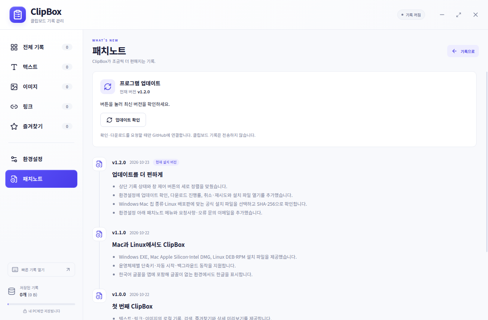

# ClipBox 1.2.0 화면 둘러보기

[다운로드·설치](INSTALL.md) · [사용법](GETTING_STARTED.md) · [업데이트 안내](08_UPDATES.md) · [저장소로 돌아가기](../README.md)

## 기록 관리

텍스트·링크·이미지를 한곳에서 찾고, 선택한 기록의 원문과 정보를 확인합니다. 별을 눌러 자주 쓰는 내용을 즐겨찾기에 모아 둘 수 있습니다.



## 빠른 팝업

작은 창에서 검색하고 방향키로 기록을 선택합니다. Enter를 누르면 복사 후 닫히며, 대상 앱에서 Windows·Linux는 Ctrl+V, Mac은 ⌘+V로 붙여넣습니다.



## 환경설정

수집·일시정지, 단축키, 저장 개수와 보관 기간, 화면 테마를 설정합니다.



## 업데이트 확인과 문의

환경설정의 **프로그램 업데이트**에서 최신 버전을 확인합니다. 아래 화면은 공개 GitHub 릴리스에서 **v1.2.0이 최신 버전**임을 실제로 확인한 결과입니다. 요청사항·오류 문의 주소는 **tree_view@naver.com**입니다.



새 버전이 있을 때의 다운로드·설치 순서는 [업데이트 안내](08_UPDATES.md)를 참고하세요.

## 패치노트

왼쪽 **환경설정 바로 아래 → 패치노트**에서 버전별 변경 내역을 확인합니다.



## 다크 테마

시스템 테마를 따르거나 라이트·다크를 직접 선택할 수 있습니다.



## OS별 설치된 앱

아래 이미지는 1.2.0 설치 파일로 각 OS에서 실행한 실제 화면입니다. Windows는 NSIS 설치 후, Mac은 각 CPU의 DMG에서 앱을 복사한 후, Ubuntu는 DEB 설치 후 Xvfb/X11에서 촬영했습니다. 새 CI 프로필에서 수집을 끈 상태입니다. 이미지를 누르면 원본 크기로 볼 수 있습니다.

| Windows x64 | Mac · Apple Silicon |
|---|---|
| [](../artifacts/qa/v1.2.0/native-win32-x64.png) | [](../artifacts/qa/v1.2.0/native-darwin-arm64.png) |

| Mac · Intel | Linux · Ubuntu X11 |
|---|---|
| [](../artifacts/qa/v1.2.0/native-darwin-x64.png) | [](../artifacts/qa/v1.2.0/native-linux-x64.png) |

[OS별 검증 범위](08_UPDATES.md#설치된-12-앱-검증) · [패키지 검증 결과](../artifacts/qa/v1.2.0/release-verification.json)

## 이미지 출처와 재촬영

- 기능 소개 6장은 **2026-10-23**, Windows에서 1.2.0 소스의 프로덕션 빌드를 실제 Electron으로 실행해 촬영했습니다. 목업이나 합성 UI가 아닙니다.
- 기록 12개는 공개용 예시입니다. 실제 사용자 기록과 클립보드는 읽지 않았습니다. 임시 프로필에서 수집 OFF·일시정지·자동 시작 OFF를 유지했습니다.
- 실행 중인 사용자 앱의 단축키와 충돌해 촬영 프로필만 **Ctrl+Alt+Shift+F12**로 변경했습니다. 제품 기본값은 Windows·Linux **Ctrl+Shift+V**, Mac **⌘+Shift+V**입니다.
- 환경설정의 자동 시작은 소스 실행에서 비활성화됩니다. 설치된 앱에서는 해당 OS 지원 범위에 따라 사용할 수 있습니다.
- 업데이트·문의 이미지는 실제 화면의 해당 영역만 캡처했습니다. 픽셀 보정이나 시험용 업데이트 응답은 사용하지 않았습니다.
- OS별 화면은 [1.2 패키지 CI](https://github.com/treeview-official/ClipBox/actions/runs/39910839386)에서 생성한 원본이며, 이번에 다시 OS별 검수를 수행했다는 의미는 아닙니다.

개발 환경에서 `npm ci`, `npm run build` 후 아래 명령을 실행하면 현재 버전 폴더에 다시 촬영합니다. 공개 최신 버전이 소스 버전과 일치해야 합니다.

```sh
node --import tsx scripts/screenshots.mjs
```

[촬영 결과](images/v1.2.0/capture.json) · [이전 버전·검증용 이미지 안내](README.md#이전-버전과-검증용-이미지)
